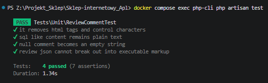
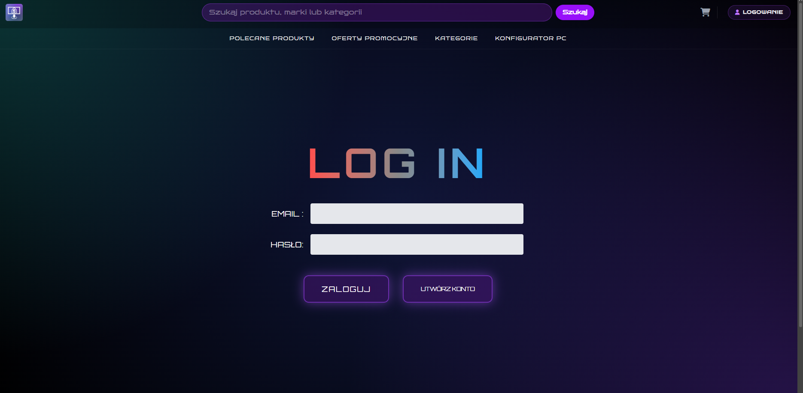
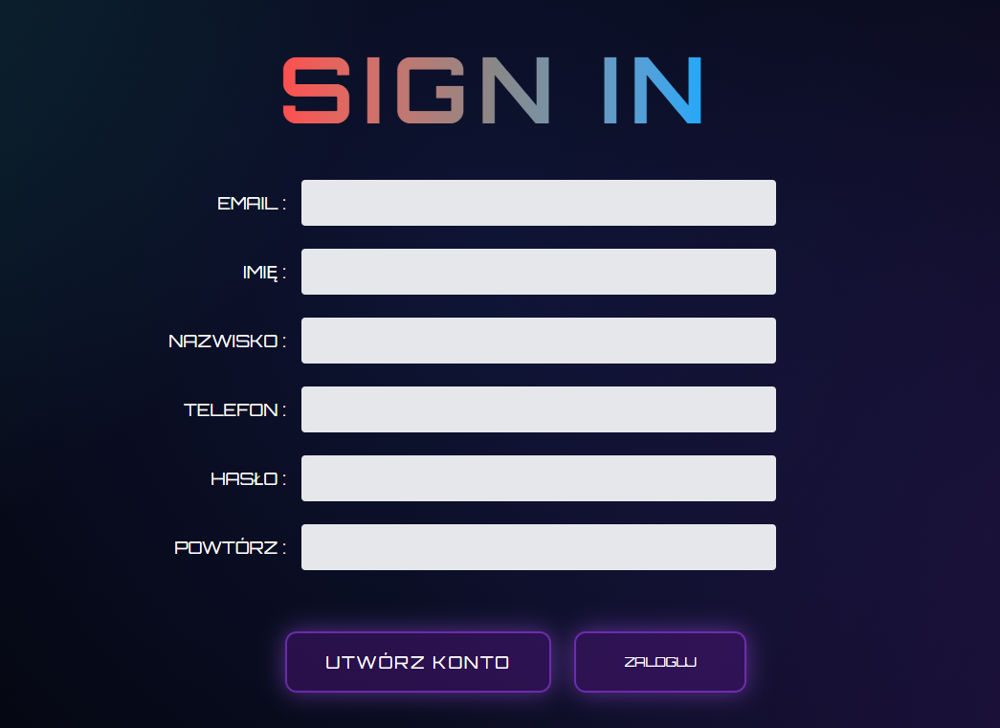
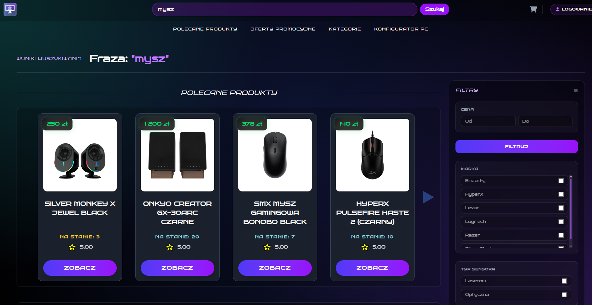
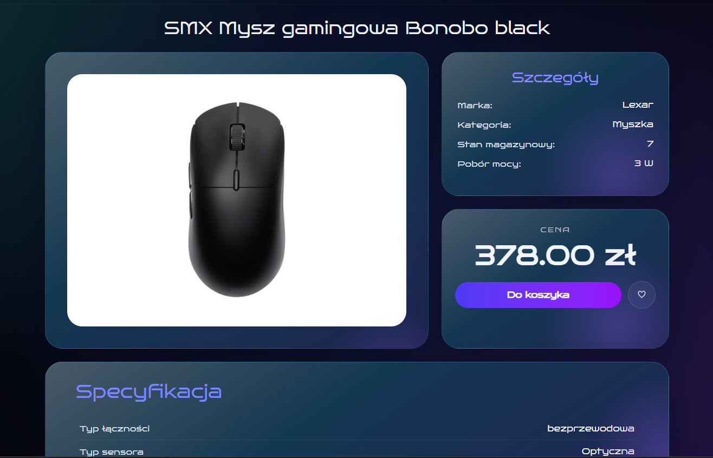
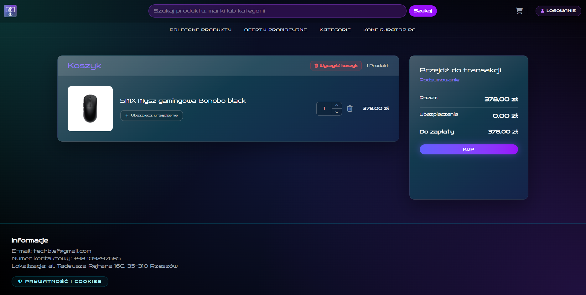
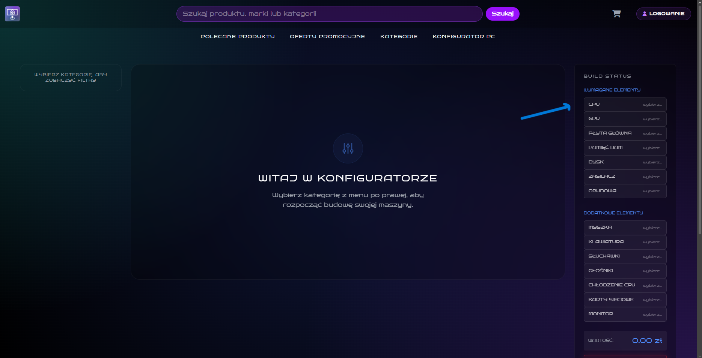
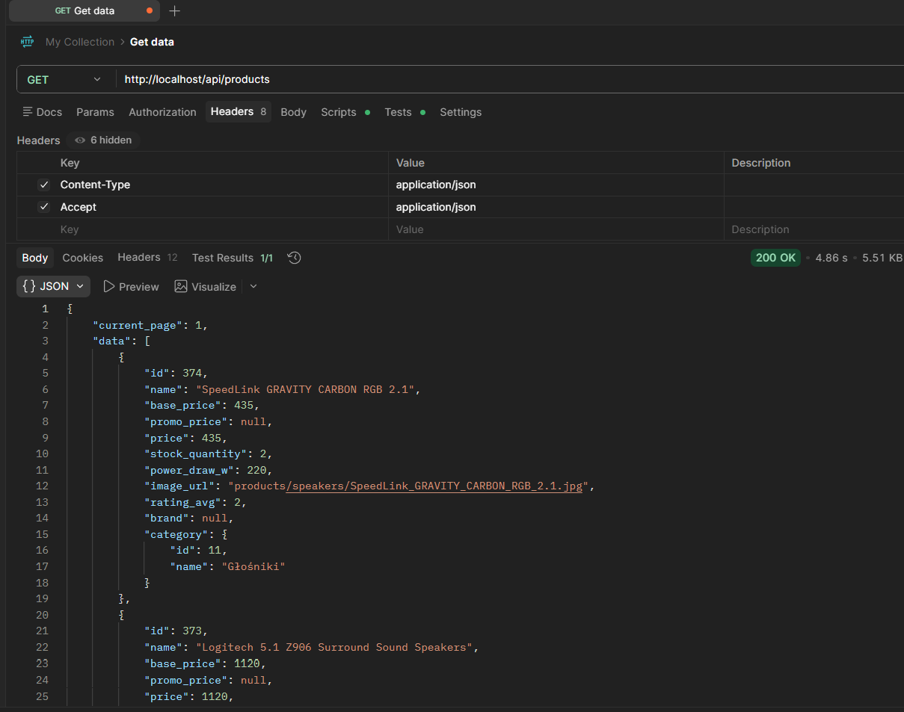
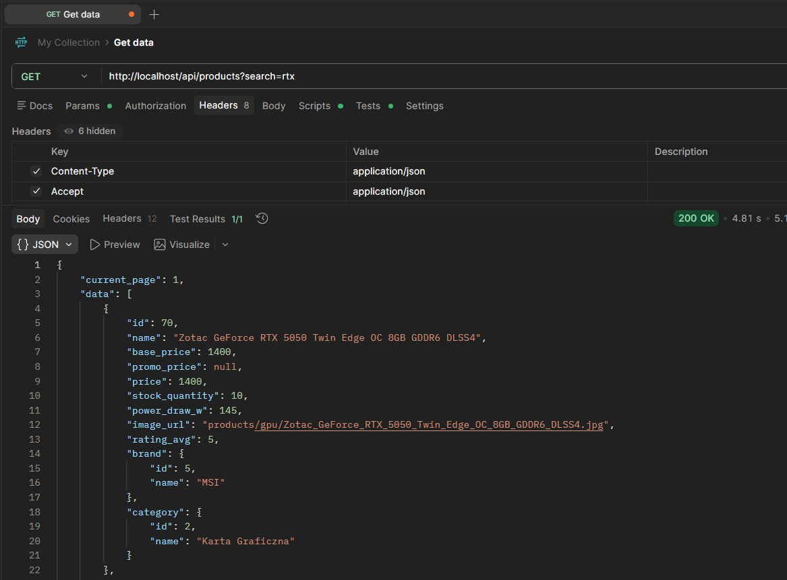
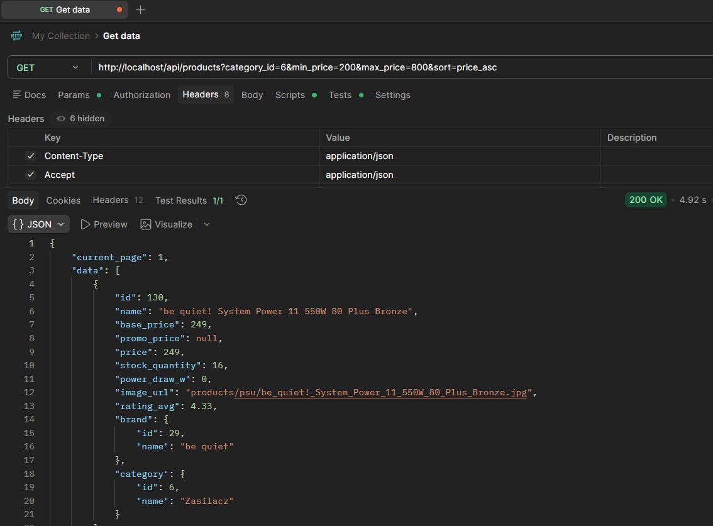

# Techblef - sklep internetowy z konfiguracją zestawu komputerowego

Techblef jest aplikacją internetową typu CMS/e-commerce przeznaczoną do
przeglądania, wyszukiwania i kupowania podzespołów komputerowych. System
udostępnia klientom katalog produktów, konfigurator kompatybilnego zestawu,
koszyk, składanie zamówień, listy obserwowanych produktów oraz obsługę
reklamacji. Administrator otrzymuje panel zarządzania produktami,
użytkownikami, stanami magazynowymi i reklamacjami.

Repozytorium projektu:
[github.com/Michalblaz/Sklep-internetowy_Apl](https://github.com/Michalblaz/Sklep-internetowy_Apl)

## Autorzy i podział ról

Podział został opracowany na podstawie historii commitów w repozytorium.

| Autor | Główne obszary odpowiedzialności |
|---|---|
| Michał Błaż | Projekt bazy danych, konfigurator zestawu, kompatybilność podzespołów, , Ekran Strony logowania oraz Rejestracji |
| Jakub Chmiel | Strona startowa, panel administratora, zarządzanie użytkownikami i banami, filtrowanie, reklamacje, statystyki |
| Kornel Barć | Wyszukiwarka produktów, strona wyników wyszukiwania, widok transakcji i logika , koszyk , walidacja profilu  |
| Kamil Harczuk | Profil użytkownika, listy obserwowanych produktów, widok szczegółów produktu, komentarze i oceny |
| Jakub Jakielaszek | Wsparcie konfiguracji środowiska Docker |

## Użyte technologie

### Backend

- PHP 8.5 w kontenerze Docker
- Laravel 13
- Livewire 4
- Eloquent ORM 
- PostgreSQL 18


### Frontend

- Blade
- Tailwind CSS 4
- JavaScript
- Vite 7

### Infrastruktura

- Docker Compose
- Nginx
- PHP-FPM
- Git i GitHub

## Przeznaczenie aplikacji

Aplikacja wspiera proces sprzedaży podzespołów komputerowych. Klient może
znaleźć produkt według nazwy i parametrów, porównać dostępne warianty,
zbudować kompatybilny zestaw komputerowy oraz złożyć zamówienie. Po
zalogowaniu użytkownik otrzymuje spersonalizowane rekomendacje, historię
zamówień, listy obserwowanych produktów i możliwość kontaktu ze sklepem
w ramach reklamacji.

Panel administratora służy do zarządzania ofertą i bieżącą obsługą sklepu.


## Przykładowe kierunki dalszego rozwoju

- dodanie uwierzytelniania API przy pomocy Laravel Sanctum,
- dodanie faktur PDF i integracji z rzeczywistym operatorem płatności,
- integracja z API firm kurierskich i mapą punktów odbioru,
- rozszerzenie testów jednostkowych, funkcjonalnych i integracyjnych,
- poprawa dostępności zgodnie z WCAG,


## Funkcjonalności

### Katalog i wyszukiwanie

- wyszukiwanie produktów po nazwie, marce, kategorii i wartościach atrybutów,
- podpowiedzi wyszukiwania zwracane asynchronicznie,
- filtrowanie po kategorii, marce, cenie, ocenie, dostępności i atrybutach,
- sortowanie po cenie, nazwie, ocenie, dostępności i dacie dodania,
- paginacja wyników,
- produkty promowane i spersonalizowane rekomendacje,
- szczegóły produktu wraz ze specyfikacją, ocenami i komentarzami.

### Konfigurator komputera

- wybór podzespołów według kategorii,
- sprawdzanie kompatybilności wybranych części,
- filtrowanie i sortowanie pasujących produktów,
- zmiana lub usuwanie elementów zestawu,
- przeniesienie gotowego zestawu do koszyka.

### Konto użytkownika

- rejestracja, logowanie i wylogowanie,
- edycja imienia, nazwiska, adresu e-mail, telefonu, hasła i adresu,
- walidacja zmiany danych oraz weryfikacja aktualnego hasła,
- historia zamówień i aktualne statusy przesyłek,
- tworzenie list obserwowanych produktów,
- składanie reklamacji lub zwrotu,
- konwersacja klienta z administratorem w ramach zgłoszenia.

### Koszyk i zamówienia

- koszyk działający dla gościa i zalogowanego użytkownika,
- dodawanie, usuwanie i zmiana liczby produktów,
- opcjonalne ubezpieczenie produktu,
- wybór istniejącego lub nowego adresu dostawy,
- wybór sposobu dostawy i punktu odbioru,
- wybór kuriera,
- płatność demonstracyjna BLIK, kartą lub przy odbiorze,
- walidacja formularza zamówienia,
- zapis zamówienia i jego pozycji w bazie danych.

### Panel administratora

- statystyki klientów, odwiedzin, zamówień i stanów magazynowych,
- dodawanie i edycja produktów,
- archiwizacja oraz przywracanie produktów,
- filtrowanie produktów o niskim stanie magazynowym,
- filtrowanie użytkowników,
- zawieszanie, banowanie i odblokowywanie kont,
- obsługa reklamacji i zwrotów,
- odpowiadanie klientom i zmiana statusu zgłoszenia.

### Walidacja i bezpieczeństwo

- walidacja danych po stronie backendu Laravel,
- podstawowa walidacja formularzy po stronie przeglądarki,
- hashowanie haseł,
- ochrona CSRF formularzy,
- middleware wymagające zalogowania i uprawnień administratora,
- ograniczanie liczby żądań przez `throttle`,
- zapytania budowane przez Eloquent i Query Builder,
- parametry wiązane w zapytaniach surowych,
- kody HTTP między innymi `204`, `400`, `401`, `403`, `404` i `422`,
- nagłówki bezpieczeństwa dodawane przez middleware.


## Baza danych

### Schemat ERD


Projekt wykorzystuje PostgreSQL. Schemat jest tworzony automatycznie przez
migracje, a dane demonstracyjne są ładowane przez seeder `StoreSeeder`.

Najważniejsze zasoby:

- użytkownicy i adresy,
- produkty, marki, kategorie i atrybuty,
- koszyki, zamówienia i sposoby dostawy,
- oceny i komentarze,
- listy obserwowanych produktów,
- reklamacje i wiadomości,
- historia przeglądania oraz statystyki odwiedzin.

### Schemat

Pełny schemat bazy znajduje się w:
`laravel/database/seeders/sql/store_schema.sql`.

## Struktura projektu

```text
.
|-- compose.yaml                    # definicja usług Docker Compose
|-- nginx/                          # konfiguracja i obraz Nginx
|-- php-fpm/                        # obraz aplikacji PHP-FPM
|-- laravel/
|   |-- app/Http/Controllers/       # kontrolery aplikacji
|   |-- app/Models/                 # modele domenowe
|   |-- app/Livewire/               # komponenty Livewire
|   |-- database/migrations/        # migracje bazy danych
|   |-- database/seeders/           # automatyczne dane startowe
|   |-- resources/views/            # widoki Blade
|   |-- resources/js/               # kod JavaScript
|   |-- resources/css/              # style
|   |-- routes/web.php              # trasy aplikacji
|   `-- tests/                       # testy automatyczne
`-- README.md
```

## Wymagania uruchomieniowe

- Docker Desktop lub Docker Engine z Docker Compose,
- Git,
- wolne porty `80` i `5432`.

Lokalne instalowanie PHP, PostgreSQL i Nginx nie jest wymagane.

## Uruchomienie krok po kroku

1. Sklonuj repozytorium:

   ```bash
   git clone https://github.com/Michalblaz/Sklep-internetowy_Apl.git
   cd Sklep-internetowy_Apl
   ```

2. Zbuduj i uruchom kontenery:

   ```bash
   docker compose up -d --build
   ```

3. Otworz aplikacje:

   - sklep: [http://localhost](http://localhost)
   - kontrola stanu Laravel: [http://localhost/up](http://localhost/up)

Seeder tworzy konto administratora o adresie `admin@admin`.
## Automatyczne seedowanie

Przy starcie kontener `php-fpm` wykonuje `php artisan migrate --force`.
Dane demonstracyjne sa ładowane przez `php artisan db:seed --force` tylko wtedy, gdy tabela `products` jest pusta, dzieki czemu zwykły restart kontenerow nie duplikuje produktow.

Ręczne uruchomienie migracji lub seedera:

```bash
docker compose exec php-fpm php artisan migrate --force
docker compose exec php-fpm php artisan db:seed --force
```

Ponowne utworzenie bazy od zera:

```bash
docker compose exec php-fpm php artisan migrate:fresh --seed --force
```

Polecenie usuwa istniejące dane.
## Testy

Uruchomienie testów:

```bash
docker compose exec php-fpm php artisan test
```

Projekt zawiera testy zabezpieczenia komentarzy produktów przed
niebezpiecznym kodem HTML i JavaScript. Przed oddaniem projektu zalecane jest
dodanie testów funkcjonalnych dla logowania, wyszukiwania, koszyka,
zamówienia, profilu i panelu administratora.




## Reprezentatywny przebieg użytkownika

Przykładowy proces złożenia zamówienia:


1. okno logowania na głownej stronie przenosi nas do panelu.

2. opcja rejestracji na głownej stronie przenosi nas do panelu rejestracji.

3. Wyszukiwanie produktu w panelu wyszukiwania.

4. Przeglądamy stronę produktu gdzie mamy opinie oraz specyfikacje możemy bezpośrednio z tąd dodać do koszyka.

5. Po wejściu do koszyka, użytkownik ustala ilości produktów które chce kupić i wybiera ubezpieczenie.

6. Opcjonalnie można użyć konfiguratora, aby zbudować dobry zestaw kompatybilnych podzespołów.



## Obsługa błędów i kody HTTP

Aplikacja wykorzystuje mechanizmy Laravel do walidacji i obsługi błędów:

- `401 Unauthorized` dla operacji JSON wymagających logowania,
- `403 Forbidden` dla użytkownika bez uprawnień administratora,
- `404 Not Found` dla nieistniejących zasobów,
- `422 Unprocessable Content` dla błędów walidacji,
- `204 No Content` dla operacji zakończonych bez treści odpowiedzi,
- komunikaty sesyjne po poprawnych lub nieudanych operacjach formularzy.

## Interfejs HTTP i REST API

Aplikacja posiada endpointy zwracające JSON, wykorzystywane między innymi
przez podpowiedzi wyszukiwania, koszyk i listy obserwowanych produktów.
Przykłady:

| Metoda | Endpoint | Działanie |
|---|---|---|
| `GET` | `/wyszukiwanie/podpowiedzi` | Zwraca podpowiedzi produktów w JSON |
| `POST` | `/koszyk/dodaj` | Dodaje produkt i zwraca odpowiedź JSON |
| `POST` | `/koszyk/aktualizuj` | Aktualizuje ilość produktu |
| `GET` | `/products/{id}/wishlists` | Zwraca listy obserwowanych użytkownika |
| `POST` | `/products/{id}/wishlists` | Zapisuje produkt na wybranej liście |


Aplikacja udostępnia proste REST API w formacie JSON pod prefiksem /api.

 Dostępne endpointy pozwalają pobierać status API :
- listę produktów
- szczegóły produktu
- kategorie
- marki. 
 
Lista produktów obsługuje wyszukiwanie, filtrowanie, sortowanie i paginację.
Przykłady użycia:

Pokazanie produktów: http://localhost/api/products



Wyszukiwanie: http://localhost/api/products?search=rtx



lub wiele filtrów naraz: http://localhost/api/products?category_id=6&min_price=200&max_price=800&sort=price_asc



